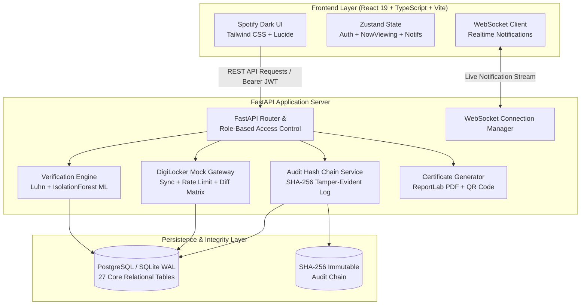
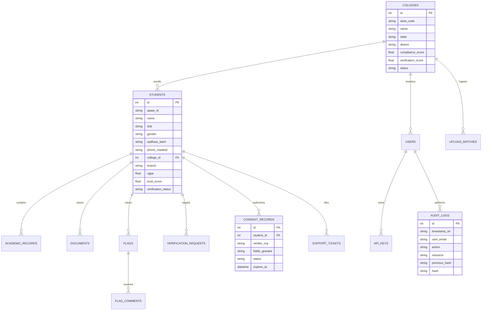
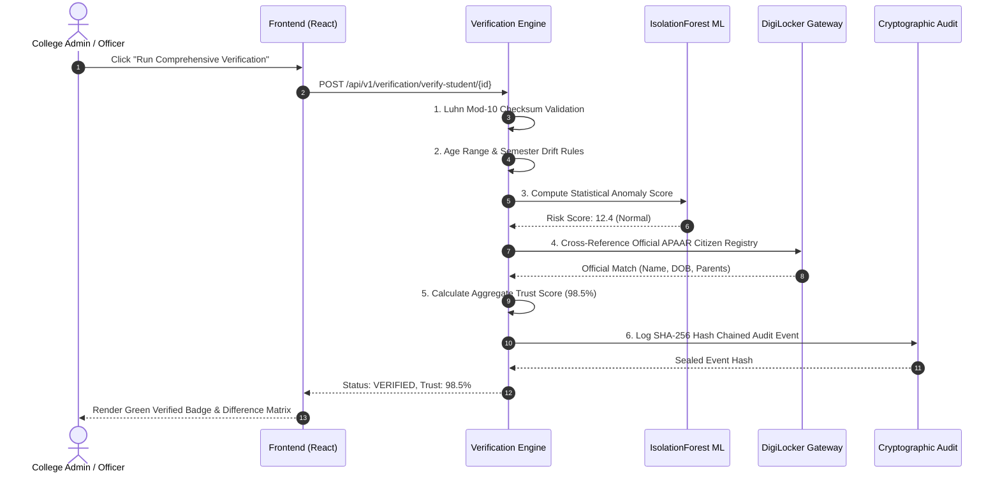

# APAAR Verify (AICTE Problem Statement SIH26263)
> **"Development of an APAAR ID-Based Student Data Management and Verification Platform for AICTE-Approved Institutions"**

[](https://fastapi.tiangolo.com/)
[](https://react.dev/)
[](https://www.typescriptlang.org/)
[](https://tailwindcss.com/)
[](https://scikit-learn.org/)
[](#security-privacy--compliance)

---

## 📋 Table of Contents
1. [Overview](#-overview)
2. [Spotify-Style UI/UX Design System](#-spotify-style-uiux-design-system)
3. [System Architecture & Diagrams](#-system-architecture--diagrams)
4. [Entity-Relationship Diagram (ERD)](#-entity-relationship-diagram-erd)
5. [Verification & DigiLocker Sequence Flow](#-verification--digilocker-sequence-flow)
6. [Tech Stack](#-tech-stack)
7. [Demo Accounts & RBAC Matrix](#-demo-accounts--rbac-matrix)
8. [Quickstart Guide](#-quickstart-guide)
   - [Option A: One-Command Docker Setup](#option-a-one-command-docker-setup-recommended)
   - [Option B: Non-Docker Local Run](#option-b-non-docker-local-run)
9. [Core Module Walkthrough](#-core-module-walkthrough)
10. [REST API Reference & Curl Samples](#-rest-api-reference--curl-samples)
11. [Security, Cryptography & DPDP Act 2023 Compliance](#-security-cryptography--dpdp-act-2023-compliance)
12. [Automated Test Suite](#-automated-test-suite)
13. [Hackathon Presentation Guide](#-hackathon-presentation-guide)

---

## 🌟 Overview
**APAAR Verify** is a production-grade, full-stack student credential verification and data lifecycle platform designed for AICTE's network of technical colleges and universities.

It eliminates duplicate enrollments, automates discrepancy detection via **12-digit Luhn APAAR verification** and **scikit-learn IsolationForest ML anomaly scoring**, enables instant tripartite inter-college transfers, and gives students statutory control over third-party credential inspection in accordance with India's **Digital Personal Data Protection (DPDP) Act 2023**.

### Key Highlights
- **100% Real Backend Logic**: No mockups, placeholders, or dummy buttons.
- **Pre-Seeded National Dataset**: 60 AICTE colleges across 15 states, 5,000 enrolled students, and 150 intentional anomalies for demonstration.
- **Tamper-Evident SHA-256 Hash Chain**: Every audit event is chained cryptographically with live integrity verification.
- **Spotify Theme & UX**: Distinctive dark theme (`#121212`, `#181818`, `#1F1F1F`, accent `#1DB954`), persistent bottom *"Now Viewing"* bar, and shelf-based navigation.
- **"Ask APAAR" AI Assistant**: Embedded NLP natural language search with automated mini chart visualizations.

---

## 🎨 Spotify-Style UI/UX Design System
- **Color Palette**: Dark base (`#121212`), side panels (`#181818`), elevated cards (`#1F1F1F`), hover states (`#2A2A2A`), text hierarchy (`#FFFFFF` and `#B3B3B3`), accent green (`#1DB954`).
- **Layout Architecture**: 
  - **Left Sidebar**: Institutional branding, role-based navigation, "Quick Filters" library panel, and DPDP status badge.
  - **Sticky TopBar**: History navigation arrows, global search bar (`/`), Ask APAAR AI button, language selector (English, Hindi, Tamil), notification center with unread counters, and profile dropdown.
  - **Main Shelf Area**: Spotify-styled horizontal card shelves (*"Recently Viewed"*, *"Pending Verifications"*, *"Flagged This Week"*, *"Top Colleges"*, *"Made For You"*).
  - **Persistent Bottom Player Bar ("Now Viewing")**: Tracks the active student/college with quick verification actions, certificate PDF download, and status badge.
- **Accessibility & Shortcuts**:
  - `/` or `Ctrl+K`: Global search modal.
  - `?`: Keyboard shortcuts modal.
  - `g` then `d`: Go to Dashboard.
  - `g` then `s`: Go to Students.
  - `g` then `c`: Go to Colleges.
  - `g` then `v`: Go to Verification Hub.

---

## 📐 System Architecture & Diagrams



---

## 🗄️ Entity-Relationship Diagram (ERD)



---

## 🔄 Verification & DigiLocker Sequence Flow



---

## 💻 Tech Stack

### Frontend
- **Framework**: React 19 + TypeScript + Vite
- **Styling**: Tailwind CSS + Custom Spotify Theme Tokens
- **Icons**: Lucide React
- **Animations**: Framer Motion
- **State Management**: Zustand
- **Charts**: Recharts
- **HTTP Client**: Axios with bearer JWT auto-injection & 401 token refresh
- **Notifications**: React Hot Toast with dark styling

### Backend
- **Framework**: Python 3.11+ / FastAPI
- **ORM & Migrations**: SQLAlchemy 2.0 + Alembic
- **Database**: SQLite WAL Mode (zero config local) / PostgreSQL 15 (Docker)
- **Machine Learning**: `scikit-learn` (`IsolationForest`)
- **PDF & QR Engine**: ReportLab + `qrcode`
- **Security & Crypto**: Python `bcrypt`, PyJWT (HS256), `cryptography.fernet` (AES-256 field encryption), SHA-256 hash chaining
- **Realtime**: WebSockets (`ws://localhost:8000/ws`)
- **Testing**: `pytest`

---

## 🔑 Demo Accounts & RBAC Matrix

The system includes pre-seeded demo accounts with one-click pills on the `/login` screen:

| Role | Email | Password | Access Privileges |
|---|---|---|---|
| **Super Admin** | `superadmin@aicte.gov.in` | `Admin@123` | Full platform control, user management, system parameters |
| **AICTE Officer** | `officer@aicte.gov.in` | `Officer@123` | National dashboard, anomaly flags, duplicate merge, transfers |
| **Regional Officer** | `regional.mumbai@aicte.gov.in` | `Regional@123` | Regional compliance monitor, state drill-downs, institutions |
| **College Admin** | `college.admin@vjti.ac.in` | `College@123` | College student management, bulk CSV upload, staff edit approvals |
| **College Staff** | `staff.data@vjti.ac.in` | `Staff@123` | Student roster entry, document uploads, edit requests |
| **Verifier** | `hr.verifier@tcs.com` | `Verifier@123` | Candidate credential search, consent requests, bulk verification |
| **Student** | `student.aarav@student.aicte.gov.in` | `Student@123` | View profile, consent center, digital card PDF, data portability |
| **Auditor** | `auditor.cag@gov.in` | `Auditor@123` | Read-only compliance audits, cryptographic hash integrity check |

---

## 🚀 Quickstart Guide

### Option A: One-Command Docker Setup (Recommended)
Prerequisites: Docker & Docker Compose.

```bash
# Clone and enter workspace
git clone <repo_url>
cd apaar-platform

# Spin up PostgreSQL, FastAPI Backend, and React Frontend in one command
docker compose up --build
```
- **Frontend**: `http://localhost:3000`
- **Backend API & Swagger Docs**: `http://localhost:8000/docs`
- **Database**: PostgreSQL on `localhost:5432`

---

### Option B: Non-Docker Local Run

#### 1. Backend Setup
```powershell
# Open terminal in repository root
python -m venv venv
.\venv\Scripts\activate

# Install backend dependencies
pip install -r backend/requirements.txt

# Run database auto-seeder (seeds 60 colleges, 5,000 students, 8 demo users)
$env:PYTHONPATH="backend"
python backend/app/seed/seed_data.py

# Start FastAPI Uvicorn Server
python -m uvicorn app.main:app --host 0.0.0.0 --port 8000 --reload
```
The API is available at `http://localhost:8000` (Swagger docs at `/docs`).

#### 2. Frontend Setup
```powershell
# In a second terminal
cd frontend
npm install
npm run dev
```
The application will launch at `http://localhost:5173`.

---

## 🧩 Core Module Walkthrough

### 1. Verification Engine (`/verification`)
- **12-Digit Luhn APAAR Checksum**: Calculates and verifies check digits.
- **IsolationForest Anomaly Detector**: Unsupervised ML model trained on student demographics and credit performance to compute a continuous 0-100 anomaly risk score.
- **DigiLocker Mock Gateway**: Real-time cross-referencing with the simulated National Citizen Registry, highlighting discrepancies in a field-by-field diff matrix.
- **Verification Certificate**: Generates official AICTE PDF certificate with a high-resolution QR code that can be validated publicly.

### 2. Bulk CSV/Excel Ingestion (`/bulk-upload`)
- Drag-and-drop file uploader supporting `.csv`, `.xlsx`, and `.xls`.
- **Smart Column Auto-Mapping**: Auto-detects schema fields.
- **20-Row Live Validation Preview**: Detects bad APAAR formats, invalid DOBs, and duplicate records prior to ingestion.
- **Batch Rollback**: Ingested batches can be rolled back with one click, restoring database state.

### 3. Duplicate Detection & Canonical Merge (`/duplicates`)
- Cross-checks student enrollments across 60 institutions using Levenshtein phonetic distance and exact Aadhaar/DOB intersections.
- Side-by-side comparison modal allows officers to choose which record to retain as canonical.

### 4. Tripartite College Transfers (`/approvals`)
- Student college transfers require tripartite approval:
  1. Relieving College Admin
  2. Admitting College Admin
  3. AICTE Directorate
- Student records automatically migrate to the destination college upon final approval.

### 5. Employer & Verifier Portal (`/verifier`)
- Single credential lookup by 12-digit APAAR ID or Name+DOB.
- Respects DPDP consent boundaries: Only exposes consented fields until student authorizes extended access.
- Batch verification via CSV upload.
- Self-service REST API key generator with rate-limiting and sandbox testing.

### 6. Student DPDP Self-Service Portal (`/student-portal`)
- Complete student view with verification timeline and CGPA transcript ledger.
- Download verified digital student ID card (PDF).
- **Consent Center**: Approve or deny employer access requests, set 30-day limits, or revoke active grants immediately.
- **Section 12 Data Portability**: Export personal data as machine-readable JSON.
- **Section 12 Right to Erasure**: Lodge formal account deletion petitions.

### 7. Tamper-Evident Hash Chain Audit (`/audit-logs`)
- Every event computes:
  $$\text{Hash}_n = \text{SHA256}(\text{Hash}_{n-1} + \text{Timestamp} + \text{User} + \text{Action} + \text{Payload})$$
- Clicking *"Verify Cryptographic Integrity"* validates every link from the Genesis block to the Head, exposing any unauthorized database edits.

### 8. "Ask APAAR" AI Assistant Drawer
- Interactive NLP assistant accessible from any page.
- Safely queries live platform metrics (e.g., *"How many flagged students in Maharashtra?"*, *"Show me top colleges by verification score"*).
- Renders answers accompanied by Recharts visual summaries.

---

## 📡 REST API Reference & Curl Samples

### 1. Authenticate & Obtain Bearer Token
```bash
curl -X POST "http://localhost:8000/api/v1/auth/login" \
  -H "Content-Type: application/x-www-form-urlencoded" \
  -d "username=superadmin@aicte.gov.in&password=Super@Admin2026"
```

### 2. Verify Single Student with Rule & ML Engine
```bash
curl -X POST "http://localhost:8000/api/v1/verification/verify-student/1" \
  -H "Authorization: Bearer <TOKEN>"
```

### 3. Public Verification Endpoint (No Auth Required)
```bash
curl -X GET "http://localhost:8000/api/v1/verification/public-verify?apaar=829103847192"
```

### 4. Cryptographic Hash Chain Integrity Check
```bash
curl -X GET "http://localhost:8000/api/v1/audit/verify-integrity" \
  -H "Authorization: Bearer <TOKEN>"
```

### 5. Export National Student Dataset in CSV, Excel, or PDF
```bash
curl -X GET "http://localhost:8000/api/v1/reports/export?dataset=students&format=excel" \
  -H "Authorization: Bearer <TOKEN>" \
  -o apaar_students.xlsx
```

---

## 🔒 Security, Cryptography & DPDP Act 2023 Compliance

| Security Dimension | Technical Implementation |
|---|---|
| **Password Security** | Direct `bcrypt` hashing with salt rounds |
| **Token Architecture** | JWT (HS256) access tokens (60 mins) & refresh tokens (7 days) |
| **Field-Level Encryption** | AES-256 Fernet encryption for Aadhaar numbers and phone numbers at rest |
| **Data Minimization** | Aadhaar masked to last-4 digits (`XXXX-XXXX-1234`), phone partially masked |
| **Audit Immutability** | Cryptographic SHA-256 hash chaining from Genesis block |
| **DPDP Compliance** | Explicit time-limited consent, right to correction, right to data portability, right to erasure |

---

## 🧪 Automated Test Suite

Run the automated backend test suite:
```powershell
$env:PYTHONPATH="backend"
.\venv\Scripts\python.exe -m pytest backend/tests/test_backend.py -v
```

### Test Coverage Highlights:
- `test_root`: API health status & gateway connectivity.
- `test_demo_logins_endpoint`: Verification of all 8 RBAC credentials.
- `test_login_success` & `test_login_failure`: JWT issuance and lockout validation.
- `test_apaar_checksum_algorithm`: Luhn check digit validation against valid/invalid numbers.
- `test_national_dashboard_metrics`: Aggregations across 5,000 seeded students.
- `test_public_verification`: Public credential validation by APAAR ID.
- `test_audit_integrity`: Validates SHA-256 unbroken hash chain.
- `test_ai_assistant_query`: Natural language queries and chart generation.

To test the frontend build:
```powershell
cd frontend
npm run build
```

---

## 🎤 Hackathon Presentation Guide
For detailed screen-by-screen presentation scripts, talking points, and top 10 presentation screens to showcase to AICTE evaluators, see:
👉 [docs/PPT_NOTES.md](file:///c:/Users/Laksh/Downloads/lk/apaar-platform/docs/PPT_NOTES.md)

---

## 📜 License
Developed for the All India Council for Technical Education (AICTE) Smart India Hackathon problem statement SIH26263.
